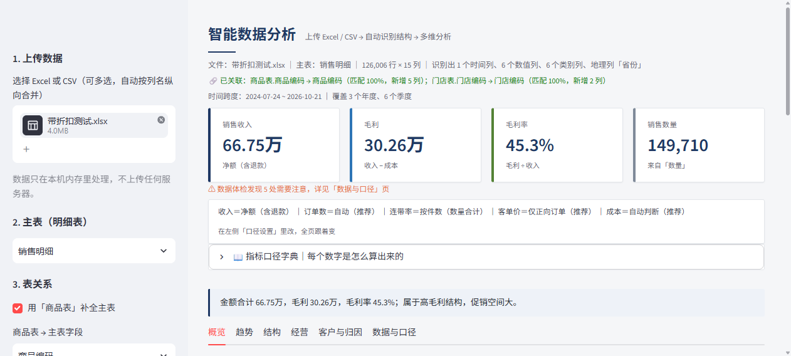

# 便利店经营分析看板

上传 Excel / CSV，自动识别表结构、建表关系，出 Power BI 风格的多维经营分析，并能导出可直接汇报的 PPT。

**在线体验**：部署后把地址填在这里（见下方「部署」）。



## 能做什么

- **自动认表**：日期/数值/类别/编号列自动识别，不用改列名；多张表按主外键自动关联（销售表只有商品编码，也能补出名称和品类）
- **多维分析**：年 / 季度 / 月 / 周 / 日 × 品类 / 商品 / 门店，趋势、构成、帕累托、热力、箱线、散点、相关矩阵、地理气泡、仪表盘
- **订单级指标**：客单价、连带率、件单价、购物篮关联规则、RFM 客户分层
- **口径可改**：9 个内置指标的公式全部可编辑，改完立即生效，可保存；支持 `[毛利] / [销售收入]` 这种引用
- **改善建议**：从数据里算出该动哪里，每条带「依据 / 怎么做 / 预期」，按优先级排序
- **导出**：Excel（多工作表）、HTML 报告、**汇报 PPT**（9 页，含图表与逐图解读）

## 用一句话问数据（中文 → SQL）

「SQL 查询」页顶部：输入「上个月各品类销售额前 5」，自动完成 解析 → 写 SQL → 执行 → 出图 → 可导出。

| 能听懂 | 例子 |
|---|---|
| 时间 | 本月 / 上月 / 今年 / 去年 / 最近 30 天 / 最近 3 个月 / 2026-08 / 8 月 / 第三季度 |
| 维度 | 品类 / 商品 / 门店 / 省份 / 城市 / 月份 / 星期 / 会员 |
| 指标 | 销售额、数量、订单数、客单价、件单价、毛利、毛利率 |
| 排序 | 前 N 名 / 最高 / 最低 |

- 会先把**「我的理解」**写出来（按什么维度、什么指标、什么时间、取几条），再给 SQL，可展开查看
- **听不懂就直说**：提示缺哪个词，并列出当前数据能按哪些维度看——不会瞎编一条 SQL
- 纯本地规则解析，**不调用任何大模型、不需要 API Key**

## 模型解读（不只是给数字）

统计建模的每一项都配了人话解释：

- **回归**：每个系数一句话——「客单价每多 1 个单位，收入平均增加 12.3（显著，p=0.004）」；再给 R² 的强度判断（很强/中等/偏弱）和「相关不等于因果」的提醒
- **聚类**：每一群自动画像——「金额偏高、数量偏低」，直接说这群是什么
- **t 检验**：显著 / 不显著，以及"不显著就别下结论"
- **折线拆解**：量、价、交互三项各自的贡献和占比

## 数据与隐私

「数据与口径」页顶部会显示当前运行位置，并说明数据去了哪：

| 模式 | 数据在哪 | 适用 |
|---|---|---|
| **本地运行**（localhost） | 只在你电脑内存里，**不出机器**，断网可用 | 真实门店/会员数据 |
| **云端运行**（*.streamlit.app） | 经 HTTPS 上传到 Streamlit 服务器内存里计算 | 演示、脱敏后的数据 |

本应用的三条保证：

1. **不写磁盘**：上传文件只在内存解析，不生成数据文件（PPT 用的临时图表生成完即删）
2. **不外发**：没有第三方统计、埋点、外部 API；问数用本地规则，不调大模型
3. **不留副本**：会话结束即释放，清洗结果与公式设置只存在当前浏览器会话

> 敏感数据（手机号、会员卡号、身份证、支付信息）请用本地版，或先删列/脱敏再上传。

## 性能（手机上不卡）

Streamlit 每次交互都会重跑整个脚本，所以做了四层优化：

| 手段 | 效果 |
|---|---|
| **会话缓存**（`perf.py`） | 体检、改善建议、订单指标、RFM、购物篮、总结只算一次；数据一换自动失效 |
| **体检抽样**（3000 行判断列类型） | 单次体检 1.2s → 0.16s |
| **模块按需渲染** | 一次只渲染当前模块，不再一次生成 25 张图 |
| **省流模式**（侧栏开关） | 图表降采样、关掉悬停交互，手机上滑动更顺 |

实测（4.2 万行数据，本机）：

| 模块 | 优化前（重跑） | 优化后（重跑） |
|---|---|---|
| 概览 | 3.30s | **0.96s** |
| 结构 | 2.95s | **1.59s** |
| 客户与归因 | 4.20s（RFM 未缓存） | **0.90s** |
| 统计建模 | — | **0.97s** |

> 手机上如果还觉得重，打开侧栏「省流模式」：散点降到 800 点、直方图分箱减半、箱线图只画 4 类、相关矩阵只取 6 列，图形更轻。

## 数据清洗（分析之前的第一步）

「数据清洗」模块：先体检，再动手，每步留痕。

**自动体检 7 类问题**

| 问题 | 为什么致命 |
|---|---|
| 完全重复的行 | 收入被重复计算，总额虚高 |
| 数字存成文本（`¥1,200`、带逗号/空格） | 求和、排序直接失效 |
| 日期存成文本（`2026/01/06` 与 `2026-01-05` 混用） | 无法按年月聚合 |
| 文本前后有空格（`"饮料 "`） | 同一品类被拆成两个 |
| 整列全空 / 只有一个取值 | 参与不了任何分析 |
| 缺失值 | 让均值、占比失真 |
| 异常值（MAD 判定） | 一个错单能把毛利率拉偏几个点 |

**可选清洗动作**：去重、文本去空格、文本转数字、文本转日期、删空列、删常量列、缺失值处理（填 0 / 填中位数 / 删行）、按 MAD 剔除异常值。

**它会做什么**

- 清洗后的数据直接喂给全站：KPI、图表、统计建模、PPT 全部基于清洗结果
- 显示前后对比（行数/列数/缺失/重复）和逐条**清洗日志**
- 随时「恢复原始数据」，不做不可逆操作
- 可下载清洗后的 CSV

> 注意：异常值默认**不**剔除——它会改变总额，属于业务判断而不是清洗动作。清洗范围 = 当前筛选后的数据集。

## 分析能力（对应初中级数据分析师的能力项）

| 能力项 | 对应功能 | 怎么用 |
|---|---|---|
| SQL 基础 → 进阶 | **SQL 查询台**（DuckDB） | 上传的表就是 `t`，支持 JOIN / 子查询 / 窗口函数 / CTE；只读，结果可下载 |
| 描述性统计 | **统计建模 → 描述统计** | 均值/中位数/标准差/分位数/偏度/变异系数，自动提示分布偏斜该怎么解读 |
| 假设检验 | **统计建模 → 两组差异** | Welch t 检验 + Cohen's d，直接告诉你差异显不显著 |
| 回归分析 | **统计建模 → 线性回归** | 系数、标准误、t、p、R²、调整 R²、F 值，并注明"相关不代表因果" |
| 聚类 | **统计建模 → K-Means** | 自实现 k-means++，结果可复现；按品类/商品/客户分组看特征 |
| 指标因果链拆解 | **统计建模 → 指标拆解** | 收入变化拆成「量」与「价」各贡献多少，三项相加严格等于总变化 |
| 用户分层 / 留存 | **客户与归因 + 复购留存** | RFM 分层 + 同期队列留存率矩阵 |
| 数据叙事 | **概览 → 汇报话术** | 自动生成能直接念的一段汇报词，数字随口径变 |
| 汇报呈现 | **导出汇报 PPT** | 9 页，每图配解读 |
| BI 仪表板 | 概览/趋势/结构/经营 | 16 类图表，按数据关系自动选型 |
| Excel | **导出 Excel** | 多工作表：核心指标 / 数据体检 / 总结 / 明细 |
| 数据清洗 | **数据清洗** | 体检 7 类问题 + 9 种清洗动作 + 前后对比 + 日志，全站跟着变 |
| 自然语言取数 | **SQL 查询 → 用一句话问数据** | 中文问题自动生成 SQL、执行、出图、导出 |
| 模型解释 | **统计建模 → 这说明了什么** | 每个系数一句话 + R² 强度 + 聚类画像 |

**没有放进网站的**（不是能力本身，而是工作方式）：Excel 手工建模、R 语言、决策树等需要本地环境的操作。
网站能覆盖的是"用数据回答业务问题"这条主链路——取数（SQL）→ 描述（统计）→ 推断（检验/回归/聚类）→ 归因（拆解/留存）→ 表达（话术/PPT）。

## 部署（Streamlit Community Cloud，免费）

1. 把这个仓库推到 GitHub（public）
2. 打开 <https://share.streamlit.io> → 用 GitHub 登录 → **Create app**
3. 选仓库，Main file path 填 `app.py`，Deploy
4. 首次构建约 3–5 分钟，之后就有公开地址 `https://<app名>.streamlit.app`

PPT 里的图表是服务端 matplotlib 画的，**服务器必须有中文字体**，否则中文会变成方框。
本仓库把 `Noto Sans SC` 放在 `assets/fonts/`（OFL 许可），构建时自动注册，不依赖系统装字体；
`packages.txt` 里的 `fonts-noto-cjk` 作为双保险。
部署页会显示当前图表字体，正常应显示 `Noto Sans CJK SC`。

不需要任何密钥。想加访问密码，在 Advanced settings → Secrets 里写：

```toml
DASH_PASSWORD = "你的密码"
```

> 数据只在浏览器会话内存里处理，不会写到服务器；上传的文件解析完就丢。

## 改完怎么更新线上页面

改完代码，双击 **`更新并推送.bat`**（或 `python push_update.py "这次改了什么"`）：

1. 自动 `git add` → `commit` → `push` 到 GitHub
2. Streamlit Cloud 监听 `master` 分支，推送后**自动重新部署**，1–2 分钟生效
3. 刷新线上地址就是最新版，不用管服务器

没有改动时脚本会直接说「没有改动，不用推」，不会产生空提交。

想看部署状态：<https://share.streamlit.io> → 你的 app → 右上角刷新按钮。

## 本地运行

```bash
pip install -r requirements.txt
streamlit run app.py
```

Windows 下双击 `网页版看板.bat` 也行。

## 文件说明

| 文件 | 作用 |
|---|---|
| `app.py` | 网页版主程序（6 个 tab 的全部分析与渲染） |
| `analytics.py` | 纯计算模块：订单级、购物篮、毛利、RFM、预测、异常、两期对比 |
| `qa_engine.py` | 问答式归因 + HTML/Excel 报告导出 |
| `extra_sections.py` | 各分析板块的 UI 与图表（订单/购物篮/毛利/RFM/目标/对比/预测/折扣退货） |
| `custom_metrics.py` | 公式求值内核（AST 白名单，不执行任意代码） |
| `metrics.py` | 指标公式引擎：内置指标也能改，支持 `[毛利] / [销售收入]` 引用 |
| `advice.py` | 改善建议：从数据算出「该动哪里」，每条带数字依据 |
| `style.py` | 统一样式与数字格式（配色、图表底样式、fmt） |
| `run_streamlit.py` | 启动器（抑制 Windows 断连噪音） |
| `test_checks.py` | 自检脚本，20 项断言 |
| `build.py` / `gen_data.py` | **旧版静态看板**（生成单文件离线 HTML，与网页版代码独立） |
| `import_data.py` | 把 POS 导出的 Excel 转成标准 CSV（配合旧版静态看板） |
| `data/` | 样例数据（pos.csv / products.csv） |
| `output/` | 生成的 HTML 报告与看板 |

> 网页版是主产品；`build.py` 那条线用于"导出一个 HTML 直接发给别人、双击就能看"，两条线不共享代码，改动时注意别混。

一个用 Python + Plotly 做的门店经营分析看板，输出**单个 HTML 文件**，双击就能在浏览器打开，不需要联网、不需要装数据库。图表样式对标 Power BI（卡片式 KPI、圆角阴影、同一套配色）。

## 怎么跑

双击 `一键运行.bat`。第一次会自动建虚拟环境、装依赖（约 1 分钟），之后直接生成看板并打开。

手动跑：
```bash
python gen_data.py   # 只在没有 data/pos.csv 时执行，生成模拟数据
python build.py      # 生成 output/便利店经营看板.html
```

## 网页版：上传即分析（推荐日常用）

双击 **`网页版看板.bat`**，浏览器会自动打开 `http://localhost:8501`，然后把 Excel 拖进去就行。

- 支持 `.xlsx / .xls / .csv`，多个 sheet 会让你选
- **列名不用改**，它自己判断哪些是日期、数值、类别、编号
- 自动挑主指标（优先 销售额/金额/数量 这类列名），也可以手动换
- 自动出：趋势图、构成环形图、Top 12 榜、分布直方图、月度热力图、相关性散点
- 附「自动结论」：集中度、等长窗口趋势对比、异常值比例、缺失/重复
- 数据只在内存里处理，不落盘、不上传

界面上左侧可以改指标/时间列/维度/日期范围，改完立刻重算。

### 时间层级（自动拆分）

每个时间列自动拆成 **年 / 季度 / 月 / 周 / 日**，左侧「时间粒度」切换，所有时间图跟着变：

- 季度按中国习惯：1-3月 Q1、4-6月 Q2、7-9月 Q3、10-12月 Q4
- 年 × 月热力图：一眼看出哪个月是旺季
- 季度对比柱：标出最高季度
- 年度对比折线：同一个月放在一起比（数据跨 2 年以上才出现）
- 仪表盘：最近一个周期 vs 上一个周期（100% = 持平）

### 图表清单（按数据类型自动选）

| 数据关系 | 用什么图 | 说明 |
|---|---|---|
| 变化趋势 | 柱 + 移动平均线 | 柱看量级，线看趋势 |
| 项目对比 | 排序条形（Top N） | 比大小最准 |
| 构成占比 | 环形图 | 看钱从哪来 |
| 层级构成 | 矩形树图（大类 → 明细） | 面积＝金额，一眼看出哪个大类靠谁撑 |
| 少数关键 | 帕累托（柱 + 累计线） | 前 20% 贡献多少 |
| 分布形状 | 直方图 | 客单价集中在哪个区间 |
| 波动/离群 | 箱线图 | 比平均值诚实 |
| 两指标关系 | 散点图 | 看相关性与离群点 |
| 多指标关系 | 相关矩阵 | 对角线＝1，找出共线性 |
| 结构与时间 | 热力图 + 堆叠柱 | 谁在哪个时间段发力、谁此消彼长 |
| 地理 | 省域气泡图 | 自动识别省份列，气泡大小＝数值 |

这套选图逻辑参考 Financial Times Visual Vocabulary 和 Abela Chart Chooser：先判断数据关系（趋势/对比/构成/分布/关系/地理），再选图。

### 数据体检（上传完第一眼就该看的）

顶部会把"数字可不可信"直接摊开，每条带结论：

- **时间断档**：序列里缺了哪几天（断档会让环比和趋势失真）
- **退款/负值行**：多少行、合计多少、当前是什么口径
- **金额校验**：`金额 = 数量 × 单价` 对不上的行数（多半是折扣，也可能是错单）
- **整行重复**：重复导出会让总额被放大
- **缺失严重**：缺超过 20% 的列，用它们做维度会掉数据
- **关联键冲突**：维表键重复多少行、按什么规则合并的
- **抽样提示 / 常量列**：哪些结论是抽样算的、哪些列没有信息量

### 口径开关（左侧）

| 开关 | 选项 | 什么时候用 |
|---|---|---|
| 对比口径 | 环比（上一期）／同比（去年同期） | 看短期波动用环比，看趋势是不是真的用同比 |
| 退款/负值行 | 计入（净额）／剔除（毛销售） | 跟财务对账用净额；看运营和单品表现用毛销售 |
| 重复键处理 | 数值平均／求和／取第一条／取最新 | 维表同编码多行时必须选，避免静默丢数据 |

选了哪一项，页面上所有结论、Q&A 归因、导出报告都会跟着变，并且在文字里写明用的是哪个口径。

### 深度分析板块（六 ~ 十二）

| 板块 | 回答什么问题 | 关键指标 |
|---|---|---|
| 六、订单视角 | 一单买多少 | 客单价、连带率、件单价、客单价分布、每日单量 |
| 七、购物篮 | 谁跟谁一起买 | 支持度、置信度、提升度、Top 组合 |
| 八、毛利结构 | 钱从哪来 ≠ 利润从哪来 | 金额占比 vs 毛利占比、毛利率差 |
| 九、客户分层 | 谁值钱、谁要流失 | RFM 五分位、分群人数/金额占比 |
| 十、目标达成 | 跟预算差多少 | 达成率、缺口、按速度推算月底 |
| 十一、任意两期对比 | 随便挑两段时间比 | 变化额、变化率、维度拆解 |
| 十二、预测与异常 | 接下来会怎样、哪天不正常 | 14 天/3 月预测 + 95% 区间、异常点标记 |

几个容易踩的坑，代码里已经处理：

- **订单号在多期导出里被复用**：自动改用「单号 + 日期」做订单键，否则连带率会被放大好几倍（页面会提示）
- **两期对比默认值**：本期＝最近 N 天、对比期＝再往前 N 天，不是两段一样的时间
- **预测**用的是移动平均 + 阻尼趋势 + 周季节性偏移，不是拍脑袋的直线；区间用残差标准差算
- **异常检测**用滚动中位数 + MAD，比 3σ 更抗极端值

### 业务总结（自动生成，不是套话）
上传后会自动算出一组结论，每条都带数字：

- 谁最赚钱（毛利冠军 / 高毛利商品 / 品类之间的利润率差）
- 卖得最好的商品及集中度
- 整体最好和最差的月份、各大类的旺淡季、一周里的规律
- 增长最快 / 下滑最快的商品（近 3 个月 vs 前 3 个月）
- 最近 30 天没动销的商品（清库存/下架候选）
- 价格带集中在哪（3 元以下 / 3-5 元 / …）
- 表里没有成本列时会明确说"算不出毛利"，不会瞎猜

### 问一句，出结论（归因分析）

在「问一句，出结论」里输入自然语言问题，或从下拉里选现成的：

> 上月销售额为什么下降？／本季度为什么上升？／今年比去年怎么样？

它会自动：找期间 → 找维度 → 做**加性分解**和**量价拆解** → 输出

- 一句话结论（本期 vs 上期、幅度、金额）
- 按 2 个维度拆解谁贡献了多少（占变动百分比）
- 销量效应 vs 价格效应各贡献多少
- 本期消失/新出现的商品（断货还是下架）
- 瀑布图 + 分组柱状图 + 明细表

**不依赖任何大模型 API**，规则解析 + 数学分解，离线可用、结果可复现。

### 导出报告

点「📄 导出完整报告」，生成一个自包含 HTML：核心指标 + 业务总结 + 归因结论 + 图表 + 明细表。
双击能打开，浏览器里 Ctrl+P 就能存成 PDF，可以直接发给老板。

### 界面

页面分成 6 个 tab，不用一路滚到底：

| Tab | 内容 |
|---|---|
| 📊 概览 | 四个核心指标 → 业务总结 → 订单级关键指标（客单价/连带率） |
| 📈 趋势 | 时间趋势、季度、年×月热力、年度对比、目标达成、预测与异常 |
| 🧩 结构 | 环形、树图、Top 榜、帕累托、品类×月份热力、堆叠、省域图 |
| 🛒 经营 | 订单视角、购物篮、毛利结构、分布与关系 |
| 👥 客户与归因 | RFM 分层、问一句归因、任意两期对比 |
| 🧪 数据与口径 | 数据概况、数据体检、**指标口径字典**、列信息、明细、Excel 导出 |

**指标口径字典**：把 23 个指标的计算公式、取数列、口径提醒全部列出来。跟财务对数之前先对一遍这张表——口径不一致时数字差多少都能解释。

### 有争议的口径，让你自己选

同样的数据，口径不同结论就不同。左侧「口径设置」里可以改 4 个高频争议项：

| 开关 | 可选 | 实测差异（同一份 12.6 万行数据） |
|---|---|---|
| 订单数怎么数 | 自动 / 订单号+日期 / 订单号原样 | 62,328 单 vs 21,110 单 |
| 连带率怎么算 | 按件数 / 按 SKU 数 | 2.41 vs 1.99 |
| 客单价含不含退款单 | 仅正向 / 含退款 | 10.85 vs 10.60 |
| 成本口径 | 自动判断 / 单价×数量 / 成本列直取 | 毛利率 45.7% vs 54.3% |

改完 **顶部会有一条口径条**，把当前生效的 5 个口径写出来（收入口径、订单数、连带率、客单价、成本），点开右侧「📖 指标口径字典」就能看到每条公式的具体写法——**选了什么，字典里就显示什么**，不会出现"说明和实际算的不一致"。


- 所有图表统一高度、白色卡片、圆角阴影，排列对齐
- 每张图右上角「⛶」点一下放到全屏大小（顶部出现，点「✕ 关闭」回去）
- 左侧可切换条形图排序（从大到小 / 从小到大）
- Excel 解析做了缓存，改设置重新出图不用再等十几秒


> 手机也能用：电脑和手机连同一个 WiFi，手机浏览器打开 `http://电脑IP:8501`。

## 多表关联（商品表 / 门店表 这种）

一张 Excel 里有多张**有关系**的表时，不用先手工 VLOOKUP：

- 主表（明细表）默认选行数最多的那张，可以改
- 系统会自动找外键：主表某列的值有 ≥90% 落在另一张表的唯一列里，就判定为关联
- 每张表一个开关 + 两个下拉（主表字段 / 对方字段），默认值就是自动猜的，猜错了你手动改
- 旁边实时显示**匹配率**和**将新增几列**，绿色＝能放心用
- 关联后，主表没有的字段（如商品名称、品类、门店名称）就能参与分析
- 维表键值有重复会警告（关联只取第一条，避免行数翻倍把总额算错）

例：销售表只有 `商品编码`，商品表有 `商品编码 / 商品名称 / 品类 / 进货价`，勾上就自动补全，图里就能按品类分析。

## 换数据：三种改法

### 改法 1（推荐）：有 POS 导出的 Excel
1. 把 Excel 丢进 `data\`，文件名随便，比如 `data\原始数据.xlsx`
2. 双击 `一键运行.bat` —— 它会自动发现 Excel、转换成标准格式、重新生成看板
3. 想单独执行就双击 `运行导入.bat`，或命令行 `python import_data.py`

列名不用改。脚本认「小票号/销售单号/交易日期/商品编码/销量/零售价/销售额」这类常见叫法，
缺「成本」「品类」会自动从 `products.csv` 补，补不上的会明确警告，不会静默算错。
认不出的列名可以打开 `import_data.py`，在开头 `ALIASES` 里加一个别名就行。

### 改法 2：直接改 CSV（适合小改动、试算）
- `data\products.csv` —— **44 行商品主数据，用 Excel 直接打开改最方便**
  改「进价」影响毛利率，改「保质期天」影响临期预警，改「当前库存」影响补货建议
- `data\pos.csv` —— 4 万多行明细，**不建议手工改**；它是导入脚本的产物

⚠ 用 Excel 另存 CSV 时选「CSV UTF-8」，否则中文会变乱码。

### 改法 3：什么都不改，先看效果
删掉 `data\pos.csv` 再双击 `一键运行.bat`，会重新生成一套模拟数据。

## 想要的结果对应的开关在哪

| 你想改 | 改哪里 | 大概位置 |
|---|---|---|
| 商品进价、售价、保质期、库存 | `data\products.csv` | 直接改数字 |
| 补货安全系数（鲜食 1.0、常温 1.3） | `build.py` | `target = v7 * 7 * 1.15` 的 `1.15` |
| 补货覆盖天数（现在是 7 天） | `build.py` | 同上，`* 7` |
| ABC 分层阈值（70%/90%） | `build.py` | `x <= 0.7` / `x <= 0.9` |
| 滞销判定（现在 14 天零动销） | `build.py` | `if q14 == 0` |
| 积压判定（现在可售 > 45 天） | `build.py` | `elif sell_days > 45` |
| 品类、SKU、门店名 | `gen_data.py` 顶部的 `PRODUCTS` 列表 | 仅影响模拟数据 |
| 看板配色、卡片样式 | `build.py` 顶部 `PALETTE` 和 CSS | — |

## 数据字段说明

**data/pos.csv** —— 门店 POS 导出的销售明细，每一行是「一个订单里的一件商品」

| 列名 | 含义 | 示例 |
|---|---|---|
| 订单号 | 同一次结账的单号 | O0000123 |
| 日期 | 交易日期 | 2026-09-01 |
| 时间 | HH:MM | 12:35 |
| 日类型 | 工作日/周末 | 工作日 |
| 天气 | 晴/阴/雨（可选，没有就填「未知」） | 晴 |
| SKU | 商品编码 | D001 |
| 名称 | 商品名 | 农夫山泉550ml |
| 品类 | 饮料/乳品烘焙/零食/鲜食/日用 | 饮料 |
| 数量 | 件数 | 1 |
| 单价 | 售价 | 2.00 |
| 金额 | 数量×单价 | 2.00 |
| 成本 | 进价×数量（没有就按进价表算） | 1.10 |

**data/products.csv** —— 商品主数据：`SKU,名称,品类,进价,售价,保质期天,当前库存`
进价和保质期决定了临期预警能不能算出来；当前库存来自进销存系统或每天的盘点表。

## 看板里有什么

| 模块 | 回答的问题 |
|---|---|
| KPI 卡（销售额/毛利/订单/客单价/周环比/SKU 数） | 门店现在什么水平 |
| 日销售额 + 7 日均线 | 趋势是涨是跌，哪天异常 |
| 品类销售结构 | 钱主要靠哪个品类赚 |
| 星期 × 时段热力图 | 哪几个小时该排人、该备货 |
| SKU 帕累托（ABC） | 哪些商品贡献 70% 销售额 |
| 关联购买 Top 10 | 什么该放在一起卖、做组合套餐 |
| 风险清单（滞销/临期/积压） | 哪些货会砸在手上 |
| 未来 7 天补货建议 | 明天该进多少 |

## 面试怎么讲这个项目

一句话版本：
> 用便利店 90 天、4.2 万条 POS 明细做门店经营诊断，构建 ABC 分层和关联规则，输出补货建议和临期预警，把鲜食损耗和滞销库存具象成可执行的补货量。

被追问时的关键点（这些才是面试官在意的）：
- **口径**：毛利率用的是 `(金额-成本)/金额`，不是 `(售价-进价)/售价` 混着用
- **ABC 阈值**：累计销售额 70%/90% 分档，不是拍脑袋按单品排名
- **关联规则的提升度**：lift = 置信度 ÷ B 的基础购买率，光看置信度会把高销商品误判成强关联
- **补货公式**：近 7 日日均 × 覆盖天数 × 安全系数 − 当前库存，安全系数可按品类调（鲜食 1.0、常温 1.3）
- **局限**：没有库存周转天数、没有促销变量、没有会员数据，所以只能做「单品级」不能做「人群级」——主动说出局限比装作完美更加分

### 新增：筛选、下钻、自定义指标

- **多条件筛选**：左侧「5. 筛选」可同时按 1–3 个维度取值过滤，条件叠加
- **下钻**：结构页环形图下方「下钻到」下拉，**选完立即生效**，可随时换成别的品类或切回「（全部）」；选项永远来自全量数据，钻进去之后照样能换
- 侧栏会显示「下钻中：品类＝零食」，也可以在那里点「✕ 退出下钻」
- **自定义指标**：数据与口径页可以用公式自己造指标，例如
  - `sum(金额) / nunique(订单号)` → 客单价
  - `(sum(金额) - sum(成本)) / sum(金额)` → 毛利率
  可用函数：sum / mean / median / min / max / std / nunique / count，结果直接出现在卡片上并写进 Excel 导出。公式用 AST 白名单求值，不会执行任意代码。

### 新增：折扣与退货

经营页多了一块，直接用表里的线索：

- **让利率**：`金额 < 单价×数量` 的行就是折扣记录，算出各品类让利金额、折扣行占比
- **退货率**：负金额行 ÷ 正向销售额，按品类排

### 新增：报告带口径

导出的 HTML 报告里多了一段「本报告口径」，把当前生效的收入/订单数/连带率/客单价/成本口径写进去——别人拿到报告不会因为口径不同再吵一遍。

### 新增：自检与锁版本

- `python test_checks.py` → 用一份手算可验的小数据跑 20 项断言（收入/成本/毛利/订单数/客单价/连带率/购物篮/自定义指标/目标达成），改完代码先跑它
- `requirements.txt` 已锁定版本：pandas 3.0.6 / plotly 7.1.0 / streamlit 1.66.0 / openpyxl 3.1.5

### 内置指标也能改公式（直接生效）

「数据与口径」页有一张「指标公式」表，9 个内置指标全部可编辑：

| 指标 | 默认公式 |
|---|---|
| 销售收入 | `sum(金额)` |
| 销售数量 | `sum(数量)` |
| 订单数 | `nunique(订单键_计算)` |
| 成本 | `sum(成本额_计算)` |
| 毛利 | `[销售收入] - [成本]` |
| 毛利率 | `[毛利] / [销售收入]` |
| 客单价 | `[销售收入] / [订单数]` |
| 连带率 | `[销售数量] / [订单数]` |
| 件单价 | `[销售收入] / [销售数量]` |

- **改完立即生效**：顶部四卡、口径字典、报告、目标达成都跟着变，不用点保存
- **可以互相引用**：`[毛利] / [销售收入]`，自动按依赖顺序求值
- **两列相乘**：`sum(进货价 * 数量)`
- **点「保存公式」** 写进 `metric_formulas.json`，下次打开还是这套；「恢复默认」一键还原
- **写错不崩**：某条公式报错只在它自己那行显示 ⚠，别的指标照常算
- 边界：公式影响的是「指标数值」，图表仍用原始列做聚合（否则分布图没法画）

### 改善建议

概览页多了「改善建议」，不是套话，每条都从这份数据里算出来，写清 **依据 → 怎么做 → 预期**，
按「高 / 中 / 低」排序。目前覆盖 10 类：

毛利率偏低/偏高 · 折扣让利过多 · 退货率 · 商品集中度与长尾 · 库存周转（>45 天预警）·
星期低谷 · 连带率偏低 · 强关联商品可捆绑 · 目标缺口（还差多少、每天要做多少）· 低毛利品类占比过高

数据健康时不会硬凑问题，而是给「增量方向」和数据缺口提示。预期影响是粗估，不是承诺。

### 导出汇报 PPT

「数据与口径」页 → 「导出汇报 PPT」→ 生成 → 下载。9 页左右，公司汇报格式（16:9）：

| 页 | 内容 |
|---|---|
| 1 | 封面：报告名、数据区间、口径、数据规模 |
| 2 | 执行摘要：4–5 条带数字的结论 |
| 3 | 核心指标：四卡 + 指标说明 |
| 4 | 趋势：收入柱 + 毛利线，右侧「解读」 |
| 5 | 品类结构：环形图 + 集中度解读 |
| 6 | 品类毛利率：对比条形 + 利润结构判断 |
| 7 | Top 10 商品：条形图 + 集中度风险 |
| 8 | 改善建议：优先级 + 依据 + 动作 + 预期 |
| 9 | 附录：口径表 + 数据质量 |

图表是 matplotlib 生成的图片（200 dpi，投屏不糊），每页右侧固定「解读」栏，写的是这份数据算出来的结论，
不是套话。版式统一：深蓝页眉条、细分割线、页码、页脚数据来源。

### 界面风格

- `ui.css` 统一视觉：深蓝主色、3px 圆角、1px 描边、去阴影，区块标题带左侧色条
- 配色集中在 `style.py`，改一处全站生效
- 顶部有「本期要点」一句话结论，汇报时可以直接念
- 标签页去掉 emoji，改成制表符式下划线选中态

